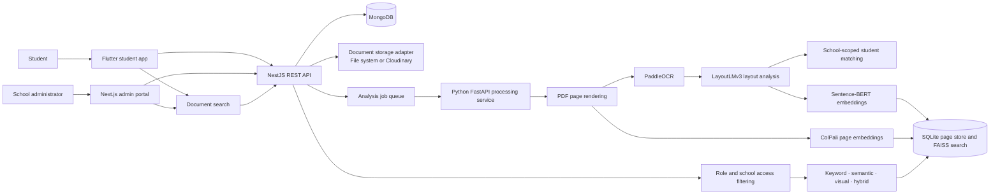
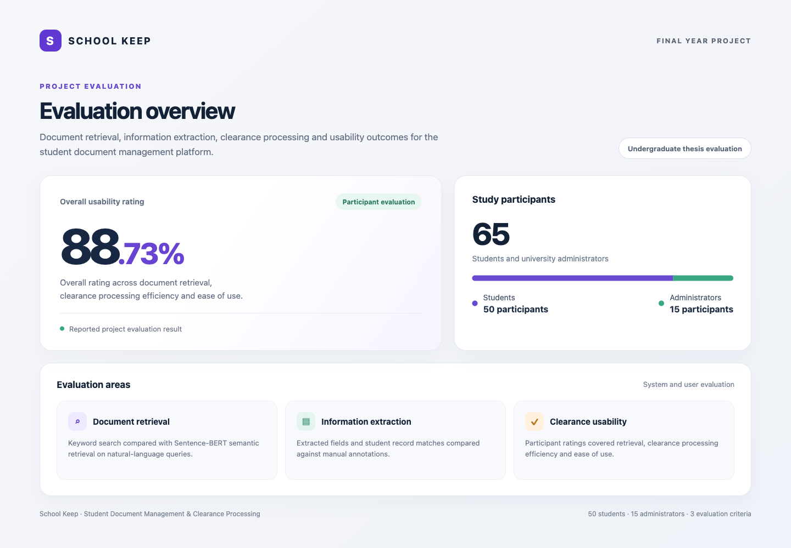

# School Keep — Final Year Project

### University Student Document Management and Clearance Processing System

> A web and mobile platform for managing student records, digitising academic documents, finding documents with natural-language search, and processing university clearance requests.

School Keep was developed as an undergraduate final year project to address paper-based student document handling and clearance workflows in Nigerian universities. The thesis, *Design and Implementation of an Online Student Document Management and Clearance Processing System*, was supervised by **Dr. Adejimi Alaba**.

## Product overview

School Keep provides separate interfaces for students and university administrators, backed by a shared API and document processing service. Students upload and organize academic records, search their documents, submit clearance materials, and follow request progress. Administrators manage student records and clearance requirements, import documents in batches, review extracted information, and approve or reject clearance requests.

The system processes scanned PDFs and images into searchable records. It combines OCR, page layout analysis, student record matching, semantic text retrieval, and visual document retrieval. Administrators can inspect the processing output and correct student or document type assignments.

## Product capabilities

| Area | Capabilities |
| --- | --- |
| Student records | Student accounts, academic profiles, document folders, document versions, and school-specific records |
| Document management | Upload, batch import, categorization, secure file access, reprocessing, and review of document analysis |
| Clearance | Configurable school and department requirements, student submissions, request status, activity history, and administrator decisions |
| Document discovery | Keyword, semantic, visual, and combined search across accessible document pages |
| Administration | School structure, faculties, departments, administrators, students, document types, and clearance workflows |
| Payments | Paid clearance requests with Squad transaction webhook processing |

## Application architecture



## Document processing

1. An administrator uploads one or more PDF, PNG, JPEG, or TIFF files, or queues an existing document for processing.
2. The API records a processing job, then the processing service renders each PDF page for analysis.
3. PaddleOCR extracts text, confidence scores, and word coordinates from each page.
4. LayoutLMv3 analyses the text and page geometry to identify form entities and key-value fields. A school-specific document classifier can be trained from reviewed document labels.
5. The matching service normalizes matriculation numbers and checks for a unique match within the same school. A match requires OCR confidence of at least `0.95` and exactly one matching student record. Uncertain matches are available for administrator review.
6. The processing service creates page-level text embeddings for semantic retrieval and visual embeddings for page-image retrieval. Analysis state and page data are persisted for search and review.

Processing status, OCR text, extracted fields, classification output, student match, and visual indexing status are available to administrators from the document review interface. Administrators make the final decisions for clearance requests.

## Document search

Search runs through the authenticated API so results are limited to the documents available to the signed-in student or administrator.

| Search mode | Implementation |
| --- | --- |
| Keyword | Case-insensitive matching against document names and OCR text extracted from pages |
| Semantic | `sentence-transformers/all-MiniLM-L6-v2` query and page embeddings, ranked with FAISS inner-product similarity over normalized vectors |
| Visual | ColPali (`vidore/colpali-v1.3`) multi-vector matching between a natural-language query and page images |
| Hybrid | Reciprocal-rank fusion of semantic and visual retrieval results |

Search results include the matching document, page number, score, and text snippet where available. Search can also be scoped to a student or folder in the admin interface.

The document API includes endpoints for batch import, background reprocessing, analysis review, training-data export, and search. Interactive API documentation is available at `/api/v1/docs` when the API is running.

## Clearance workflow

Administrators define clearance requirements for a school and assign required clearances to departments. Students submit a clearance request and its supporting documents through the mobile application, then track its progress and activity history. Administrators review submitted materials and approve or reject each clearance, with status changes recorded in the workflow. Paid clearance requests are associated with transaction records and processed through the Squad payment webhook.

## Technical stack

| Component | Technologies | Responsibilities |
| --- | --- | --- |
| Admin portal | Next.js 14, React 18, TypeScript, TanStack Query | School administration, document import and review, student records, search, and clearance management |
| Student app | Flutter, Dart | Student document upload and organization, document search, clearance requests, and status tracking |
| Application API | NestJS, TypeScript, Mongoose | Authentication, role-based authorization, school and student records, document workflows, and REST endpoints |
| Main database | MongoDB | Users, schools, students, documents, clearance records, transactions, and analysis metadata |
| Document analysis | Python, FastAPI, PaddleOCR, LayoutLMv3 | Page rendering, OCR, layout-aware extraction, classification, and student matching inputs |
| Text retrieval | Sentence-Transformers, FAISS | Dense text embeddings and similarity-based page retrieval |
| Visual retrieval | ColPali, PyTorch | Page-image embeddings and visual document retrieval |
| Page index | SQLite | Durable page text, document scope, and vector data used by the search service |
| File storage | File system or Cloudinary | Uploaded source documents and authorized document access |
| Payments | Squad webhook integration | Payment event handling for paid clearance requests |

## Evaluation

The thesis evaluation examined extracted fields and student record matching against manual annotations. It compared keyword search with Sentence-BERT retrieval using natural-language queries that did not directly match document filenames. Usability was evaluated with **50 students and 15 administrators** across document retrieval, clearance processing efficiency, and ease of use. The project reported an **overall usability rating of 88.73%**.



The repository also includes repeatable evaluation tools for document retrieval, OCR, field extraction, record matching, and usability survey responses. Results can be viewed in the Streamlit evaluation dashboard.

```bash
cd ml
.venv/bin/python -m scripts.benchmark_vidore --samples 50
.venv/bin/python -m scripts.eval_academic_forms
.venv/bin/python -m scripts.eval_usability path/to/responses.csv
.venv/bin/streamlit run dashboard.py
```

The usability CSV format is `respondent_id,role,document_retrieval,clearance_processing_efficiency,ease_of_use`. Use a unique anonymous ID, `student` or `administrator`, and a 1–5 integer rating for each criterion.

## Run the application

### Prerequisites

- Node.js 20
- Flutter with Dart 3.5 or newer
- MongoDB
- Python 3.11 or 3.12
- `uv` for Python environment and package management

### Install dependencies

```bash
cp server/.env.example server/.env
cp web/.env.local.example web/.env.local

cd server && npm ci
cd ../web && npm ci
cd ../ml && uv venv --python 3.11 .venv
uv pip install --python .venv/bin/python -e '.[test]'
cd ../app && flutter pub get
```

Set `JWT_SECRET` and `SCHOOL_MANAGERS_PASSWORD` in `server/.env`. Configure `STORAGE_DRIVER` as `cloudinary` with Cloudinary credentials to use Cloudinary storage; the file system storage adapter is also available. `MAILER_MODE=log` writes email events to the server output.

### Start services

Start MongoDB, then run the application services:

```bash
mkdir -p .school-keep-mongo
mongod --dbpath .school-keep-mongo --bind_ip 127.0.0.1 --port 27017
bash scripts/dev.sh
```

The services are available at:

| Service | Address |
| --- | --- |
| Admin portal | `http://localhost:3000` |
| API | `http://localhost:4000/api/v1` |
| API documentation | `http://localhost:4000/api/v1/docs` |
| Document processing service | `http://127.0.0.1:8001` |

Run the Flutter application with an API address for the target device:

```bash
cd app
flutter run --dart-define=API_URL=http://localhost:4000/api/v1
```

For the Android emulator, set `API_URL=http://10.0.2.2:4000/api/v1`. For a physical device, set the computer's network address in `API_URL` and `PUBLIC_API_URL`.

## Repository structure

```text
app/       Flutter student application
web/       Next.js administrator portal
server/    NestJS REST API and MongoDB models
ml/        Python document processing, search, and evaluation tools
scripts/   Application startup script
docs/      Project evaluation image
```

## Project references

- Main models: PaddleOCR, Microsoft LayoutLMv3, Sentence-BERT, FAISS, and ColPali.
- Retrieval benchmark: [ViDoRe ArxivQA dataset](https://huggingface.co/datasets/vidore/arxivqa_test_subsampled).
- Academic forms used by the evaluation scripts: [Bowen University](https://bowen.edu.ng/wp-content/uploads/2020/04/transcript-request-form.pdf), [University of Port Harcourt](https://www.uniport.edu.ng/wp-content/uploads/2024/11/APPLICATION_FORMAT.pdf), [University on the Niger](https://uniniger.edu.ng/wp-content/uploads/2023/12/Admissions-Unit-Students-Clearance-Form.pdf), and [University of Lagos](https://spgs.unilag.edu.ng/wp-content/uploads/SPGS-Clearance-Form-for-Certificate.pdf).
